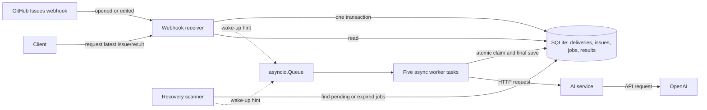

# IssueTriage

IssueTriage watches one GitHub repository and triages its issues. When an issue is opened or edited, the application saves the issue and a durable triage job. A background worker asks a small AI service to classify the issue and write a clearer summary. The client reads the latest saved result; it does not wait for AI during the webhook request.

Version 1 deliberately uses one repository, one triage application process, SQLite, and five concurrent async worker tasks. It does not require Redis, SQS, or a separate worker HTTP API.

## Architecture

The webhook receiver, queue, scanner, and five worker tasks run in **one triage application process** initially. The AI service is a separate HTTP service; it calls OpenAI and returns a result to the worker. Five async tasks are not five Uvicorn processes. Run the triage application with one Uvicorn process for version 1; adding Uvicorn processes creates separate in-memory queues in each process and needs deliberate coordination.

SQLite is the source of truth. `asyncio.Queue` contains only job IDs and helps workers wake quickly. Its contents can disappear on restart without losing a job. The recovery scanner reads SQLite on startup and periodically thereafter. The client initially refreshes or polls for results; server-sent events can be added later.

## Data and job states

The following tables describe the intended data model, not a required final schema:

| Table                | Purpose                                                                                                                                                   |
| -------------------- | --------------------------------------------------------------------------------------------------------------------------------------------------------- |
| `webhook_deliveries` | A unique GitHub delivery ID prevents redelivery from creating the same work twice.                                                                        |
| `issues`             | The latest accepted title, body, source update time, and local revision for each repository/issue pair.                                                   |
| `triage_jobs`        | One job for an issue revision, including status, attempt count, next retry time, owner token, and lease expiry. The issue/revision pair should be unique. |
| `triage_results`     | Classification and summary tied to the exact issue revision that was analyzed.                                                                            |

A job normally moves through `pending → running → completed`. A temporary failure returns it to `pending` with a later `next_attempt_at`. Repeated or permanent failure moves it to `failed` for inspection. A job for an older issue revision may become `superseded`. The UI shows a result only when its revision matches the issue's current revision.

## Flow: issue #42

1. Someone opens issue #42. GitHub sends an `issues.opened` webhook to `POST /webhooks/github`.
2. The receiver verifies the signature, checks the event and action, and deduplicates by `X-GitHub-Delivery`. In **one SQLite transaction**, it records the delivery, saves issue #42 as revision 1, and inserts pending job `J1`. If any write fails, the whole transaction rolls back.
3. After the commit, the receiver returns a successful HTTP response to GitHub. It may also put `J1` into `asyncio.Queue`, but that notification is optional for correctness. It does not call AI in the webhook request.
4. A worker gets the ID and **atomically claims** `J1` in SQLite: `status=running`, an attempt count, a unique owner token, and a lease expiry. Another worker trying the same claim does not win. The transaction ends before any network call.
5. The worker calls the AI service with the job ID, issue key, revision, title, and body. The AI service calls OpenAI and returns a classification and clearer summary. Issue text is treated as data, not as instructions to the AI service.
6. In one final SQLite transaction, the worker saves the result and marks `J1` completed **only if** its owner token is still current, its lease has not expired, and issue #42 is still at revision 1. The client can then read the result through the application API.

For one successful issue, this example performs three short database transactions: intake (delivery + issue + job), claim, and completion (result + job status). Reads and in-memory queue notifications are separate. No database transaction remains open while waiting for the AI service.

### Issue edits

If issue #42 is edited while `J1` is running, the receiver saves revision 2 and creates `J2` in one transaction. `J1` may finish, but it must not publish its revision-1 answer as the current result. `J2` produces the revision-2 answer. Check the revision **again at final save**, because an edit can arrive after the worker's initial check.

GitHub deliveries should not be assumed to arrive in issue-update order. An older delivery must not replace newer issue content. Compare source update information and, when ordering is ambiguous, fetch the current issue from GitHub before deciding what to process. This is a separate concern from deduplicating the same delivery ID.

## Failure and race behavior

| Failure or race                                          | Recovery or protection                                                                                                                                                                                                 |
| -------------------------------------------------------- | ---------------------------------------------------------------------------------------------------------------------------------------------------------------------------------------------------------------------- |
| Crash before the intake transaction commits              | Neither the issue change nor its job is saved. The webhook delivery is unsuccessful and needs redelivery.                                                                                                              |
| Crash after intake commits but before `queue.put()`      | The pending job remains in SQLite. The startup/periodic scan finds it.                                                                                                                                                 |
| Intake commits but the HTTP acknowledgment is lost       | A redelivery carries the same delivery ID; the uniqueness check prevents a second job.                                                                                                                                 |
| Two workers receive the same queued ID                   | The conditional database claim gives ownership to only one. Duplicate queue notifications are harmless.                                                                                                                |
| Worker crashes while processing                          | The job remains `running`; after its lease expires it becomes eligible for another claim.                                                                                                                              |
| Lease expires while the original worker is still running | Another worker may call AI too. Completion requires both a current owner token and an unexpired lease; the old worker's late save is rejected. This prevents a stale database result, **not** every duplicate AI call. |
| AI call times out or fails temporarily                   | Record the attempt and retry later with backoff, up to a limit. A timeout does not prove the remote service stopped processing.                                                                                        |
| AI succeeds but worker crashes before final commit       | No result is saved; the job is retried after lease expiry. The external AI call may happen twice.                                                                                                                      |
| Crash during final commit                                | Result and completed status either both commit or neither commits.                                                                                                                                                     |
| Issue is edited during an AI call                        | The completion transaction checks the issue revision; an old answer cannot become the current answer.                                                                                                                  |

Use a deadline for the **whole processing attempt** that leaves time to save the result before the lease expires, or renew the lease while working. A plain HTTP read timeout is not necessarily a deadline for the whole operation. Leases help recovery but do not guarantee exactly-once external execution. Bounded retries and a visible `failed` state prevent endless retry loops.

There is an important limit at the GitHub boundary: **GitHub does not automatically redeliver failed webhook deliveries**. For this first version, inspect and manually redeliver missed deliveries after downtime; automated redelivery can be a later feature. [GitHub's failure guidance](https://docs.github.com/en/webhooks/using-webhooks/handling-failed-webhook-deliveries) explains this behavior.

## Why this design?

- **Save the issue and work intent together.** The issue and its pending job share one SQLite transaction. A crash cannot leave a committed issue update without a committed instruction to triage it.
- **Use the queue for speed, not durability.** The scanner can recover work from SQLite after a restart or a lost notification. For this small, single-host project, a database-backed job table avoids introducing a second state store.
- **Make ownership temporary and conditional.** A lease lets a job recover after a worker crash; an owner token prevents a worker whose lease was replaced from saving a late result.
- **Expect retries and duplicates.** The database can ensure that one current result is published, but it cannot know with certainty whether an external AI call completed just before a crash. Duplicate calls may incur extra cost.
- **Version results.** Opening and editing the same issue can produce overlapping AI calls. Tying each job and result to a revision prevents an earlier answer from overwriting the latest one.
- **Keep webhook latency separate from AI latency.** GitHub receives its response after durable intake, not after classification. Workers handle the slower I/O concurrently.

Redis or a broker could become useful if job volume, multi-host deployment, or operational needs justify one. Redis is not automatically safer than SQLite for job status: marking a job complete in Redis and saving its result in SQLite would reintroduce a two-system write problem. If we later publish committed jobs to a separate durable broker, a classical **transactional outbox relay** becomes relevant. The current `triage_jobs` table already durably records work, so an additional outbox table is unnecessary for version 1.

## Concepts and sources that informed the design

This is a combination of established reliability patterns, adapted to a small project rather than copied from one reference architecture:

| Concept                                  | How it appears here                                                            | Read more                                                                                                                                                                                                                       |
| ---------------------------------------- | ------------------------------------------------------------------------------ | ------------------------------------------------------------------------------------------------------------------------------------------------------------------------------------------------------------------------------- |
| Fast, authenticated webhook intake       | Verify the signature, use delivery IDs, and acknowledge after durable intake.  | [GitHub webhook best practices](https://docs.github.com/en/webhooks/using-webhooks/best-practices-for-using-webhooks), [signature validation](https://docs.github.com/en/webhooks/using-webhooks/validating-webhook-deliveries) |
| Atomic transaction                       | Commit the issue update and pending job together.                              | [SQLite transactions](https://www.sqlite.org/lang_transaction.html), [AWS transactional outbox](https://docs.aws.amazon.com/prescriptive-guidance/latest/cloud-design-patterns/transactional-outbox.html)                       |
| Lease / visibility timeout               | An unfinished job can be reclaimed after its owner disappears.                 | [Amazon SQS visibility timeout](https://docs.aws.amazon.com/AWSSimpleQueueService/latest/SQSDeveloperGuide/sqs-visibility-timeout.html)                                                                                         |
| At-least-once processing and idempotency | Duplicate deliveries or retries must not create an incorrect result.           | [AWS idempotency guidance](https://docs.aws.amazon.com/wellarchitected/latest/framework/rel_prevent_interaction_failure_idempotent.html)                                                                                        |
| Optimistic concurrency                   | Save only if the expected issue revision and job ownership still match.        | [AWS optimistic locking explanation](https://docs.aws.amazon.com/amazondynamodb/latest/developerguide/BestPractices_OptimisticLocking.html)                                                                                     |
| Bounded retry with backoff               | Temporary AI/network failures retry later rather than immediately and forever. | [AWS retry-with-backoff pattern](https://docs.aws.amazon.com/prescriptive-guidance/latest/cloud-design-patterns/retry-backoff.html)                                                                                             |

These references explain principles; IssueTriage is not required to use AWS services. In particular, its SQLite job table is a **database-backed job queue**, while AWS's classical outbox example publishes to an external broker.

## Version 1 scope

- One repository webhook, one public callback URL, and the `issues` event with `opened` and `edited` actions.
- One triage application process with five async worker tasks; one separate AI service.
- SQLite for deliveries, issue revisions, jobs, and results; `asyncio.Queue` only as an optional wake-up hint.
- Startup and periodic recovery scans, atomic claims, leases, bounded retries, and revision-safe final saves.
- A simple client that refreshes or polls. SSE, Redis, SQS, multi-host workers, and GitHub App installation are later choices.

The first milestone is not “exactly once.” It is: **no committed job silently disappears, crashes lead to a clear retry path, and an old worker cannot publish an outdated answer.**

## Webhook setup

In a repository you own, open **Settings → Webhooks → Add webhook**. Set the payload URL to your public `https://…/webhooks/github` address, use `application/json`, configure a secret shared with the receiver, and subscribe only to **Issues**. Test by opening and editing an issue, then inspect the repository's webhook delivery history. The receiver must validate `X-Hub-Signature-256` against the raw request body before trusting the event.

This version intentionally watches one repository. More repositories can later send to the same endpoint with separate repository webhooks; an organization webhook or GitHub App is a separate expansion. See [GitHub webhook types](https://docs.github.com/en/webhooks/types-of-webhooks).
