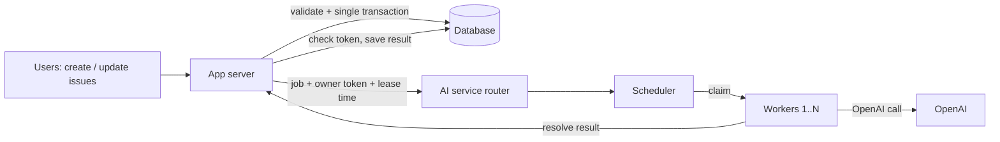
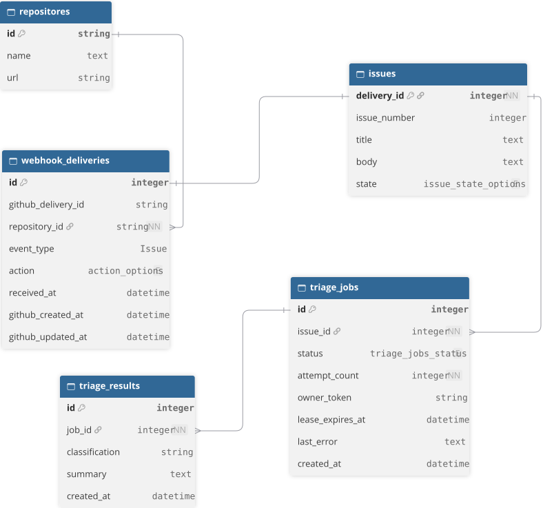

# IssueTriage

IssueTriage receives GitHub issues (created or updated) from one or more repositories, saves them with a triage job, and sends the job to a separate AI service that classifies and summarizes the issue.

## Architecture



1. **Intake.** The app server receives an issue, validates it, and saves the issue and its job in a single transaction. If the transaction fails, nothing is saved.
2. **Dispatch.** The app server sends the job to the AI service. Each job carries an **owner token** (who currently owns it) and a **lease time** (how long they may hold it).
3. **Claiming.** The AI service router passes the job to the scheduler, which assigns it to a free worker.
4. **Resolving.** The worker calls OpenAI and returns the result to the app server.

### Completion and recovery

- **Worker succeeds:** the app server looks up the job by `job_id` and token.
  - If the token matches, the job is marked done and the result is saved.
  - If the token does not match, the lease expired and the job was already resent, so this result is discarded and the job attempt is marked terminated.
- **Worker does not respond:** the app server cannot tell whether OpenAI or the AI service failed. It checks the database, and once the lease has expired it resends the job with the **same id and a new token**, so a late reply from the old attempt is rejected.

## Version 1 scope

- One repository webhook, one public callback URL, and the `issues` event with `opened` and `edited` actions.
- One triage application process with five async worker tasks; one separate AI service.
- SQLite for deliveries, issue revisions, jobs, and results; `asyncio.Queue` only as an optional wake-up hint.
- Startup and periodic recovery scans, atomic claims, leases, bounded retries, and revision-safe final saves.
- A simple client that refreshes or polls. SSE, Redis, SQS, multi-host workers, and GitHub App installation are later choices.

The first milestone is not “exactly once.” It is: **no committed job silently disappears, crashes lead to a clear retry path, and an old worker cannot publish an outdated answer.**

## Webhook setup

In a repository you own, open **Settings → Webhooks → Add webhook**. Set the payload URL to your public `https://…/webhooks/github` address, use `application/json`, configure a secret shared with the receiver, and subscribe only to **Issues**. Test by opening and editing an issue, then inspect the repository's webhook delivery history. The receiver must validate `X-Hub-Signature-256` against the raw request body before trusting the event.

This version intentionally watches one repository. More repositories can later send to the same endpoint with separate repository webhooks; an organization webhook or GitHub App is a separate expansion. See [GitHub webhook types](https://docs.github.com/en/webhooks/types-of-webhooks).

## Database Design


### Parsed webhook data

```
{
    "action": payload["action"],
    "issue": {
        "id": payload["issue"]["id"],
        "title": payload["issue"]["title"],
        "body": payload["issue"]["body"],
        "number": payload["issue"]["number"],
        "html_url": payload["issue"]["html_url"],
        "state": payload["issue"]["state"],
        "created_at": payload["issue"]["created_at"],
        "updated_at": payload["issue"]["updated_at"],
    },
    "repository": {
        "id": payload["repository"]["id"],
        "name": payload["repository"]["name"],
        "url": payload["repository"]["url"],
    },
}
```


### Relations

- A repository has many webhook deliveries: `webhook_deliveries.repository_id` references `repositories.id`.
- A webhook delivery can be referenced by many issues: `issues.delivery_id` references `webhook_deliveries.github_delivery_id`.
- An issue has many triage jobs: `triage_jobs.issue_id` references `issues.id`.
- A triage job can have many triage results: `triage_results.job_id` refers to `triage_jobs.id`, but no `FOREIGN KEY` constraint is declared for it yet.
- A delivery that arrives with a `github_delivery_id` already in the table is a redelivery. The primary key rejects the second insert.


### Table Design

The schema is defined in `database/create_db.py`, which is shared by the app and the AI service. Timestamps are stored as ISO-8601 UTC text, for example `2026-10-29T12:48:00.000Z`.

#### `repositories`

| Column | Type     | Constraints                         |
| ------ | -------- | ----------------------------------- |
| `id`   | `string` | Primary key; GitHub's repository ID |
| `name` | `TEXT`   | Not null                            |
| `url`  | `TEXT`   | Not null                            |

#### `webhook_deliveries`

| Column               | Type     | Constraints                                                      |
| -------------------- | -------- | ---------------------------------------------------------------- |
| `github_delivery_id` | `string` | Primary key; the `X-GitHub-Delivery` header value                |
| `repository_id`      | `string` | Not null; foreign key to `repositories.id`, `ON DELETE CASCADE`  |
| `event_type`         | `TEXT`   | Not null; must be `issues`                                       |
| `action`             | `TEXT`   | Not null; `opened` or `closed`                                   |
| `received_at`        | `TEXT`   | Not null; defaults to the current UTC time                       |
| `github_created_at`  | `TEXT`   | Not null                                                         |
| `github_updated_at`  | `TEXT`   | Not null                                                         |

#### `issues`

| Column         | Type      | Constraints                                                                         |
| -------------- | --------- | ----------------------------------------------------------------------------------- |
| `id`           | `INTEGER` | Primary key, `AUTOINCREMENT`                                                        |
| `delivery_id`  | `string`  | Not null; foreign key to `webhook_deliveries.github_delivery_id`, `ON DELETE SET NULL` |
| `issue_number` | `INTEGER` | Not null                                                                            |
| `title`        | `TEXT`    | Not null                                                                            |
| `body`         | `TEXT`    | Not null                                                                            |
| `state`        | `TEXT`    | Not null; `open` or `closed`                                                        |

#### `triage_jobs`

| Column             | Type      | Constraints                                                 |
| ------------------ | --------- | ----------------------------------------------------------- |
| `id`               | `INTEGER` | Primary key, `AUTOINCREMENT`                                |
| `issue_id`         | `INTEGER` | Not null; foreign key to `issues.id`, `ON DELETE CASCADE`   |
| `status`           | `TEXT`    | Not null; `pending`, `running`, `completed`, or `failed`    |
| `attempt_count`    | `INTEGER` | Not null; defaults to 0; at most 4                          |
| `owner_token`      | `TEXT`    | Not null                                                    |
| `lease_expires_at` | `TEXT`    | Not null; must be later than the current time               |
| `last_error`       | `TEXT`    | Nullable                                                    |
| `created_at`       | `TEXT`    | Not null; defaults to the current UTC time                  |

#### `triage_results`

| Column           | Type      | Constraints                                                            |
| ---------------- | --------- | ---------------------------------------------------------------------- |
| `id`             | `INTEGER` | Primary key, `AUTOINCREMENT`                                           |
| `job_id`         | `INTEGER` | Not null; refers to `triage_jobs.id` (no `FOREIGN KEY` declared)       |
| `classification` | `TEXT`    | Not null; `bug`, `feature`, `question`, `documentation`, or `other`    |
| `priority`       | `TEXT`    | Not null; `low`, `medium`, or `high`                                   |
| `summary`        | `TEXT`    | Not null                                                               |
| `created_at`     | `TEXT`    | Not null; defaults to the current UTC time                             |


### Entity Relationship Diagrams



### Normal Rules Proof


#### 1-NF

- Each table has a primary key 
- Row order does not encode an information
- An attribute (column) does not contain mixed data types [check type definition]
- No attribute (column) is not sotring a repeating group value; each attribute has atomic values


#### 2-NF

→ Primary keys: `repositories.id`, `webhook_deliveries.github_delivery_id`, `issues.id`, `triage_jobs.id`, and `triage_results.id`

- Each column contain one primary key. Therefore, no `non-key` attribute can depend on only part of the primary key. [There is no partial dependence]


#### 3-NF

→ Primary keys: `repositories.id`, `webhook_deliveries.github_delivery_id`, `issues.id`, `triage_jobs.id`, and `triage_results.id`

- Every nonkey attribute depends only with the primarly key and none other than the primary key. 

